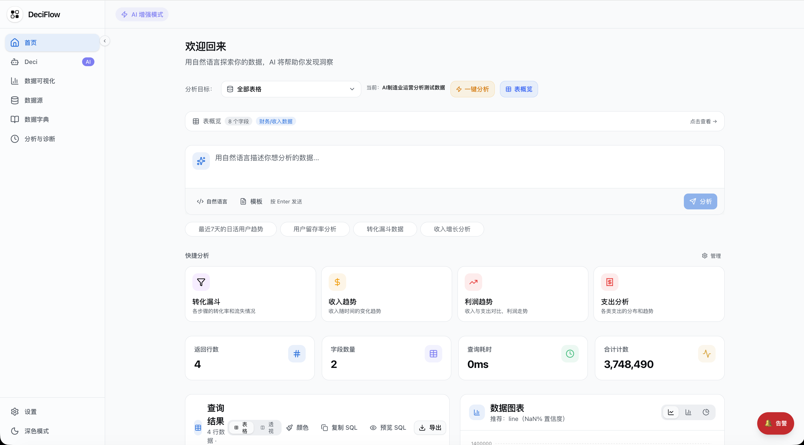
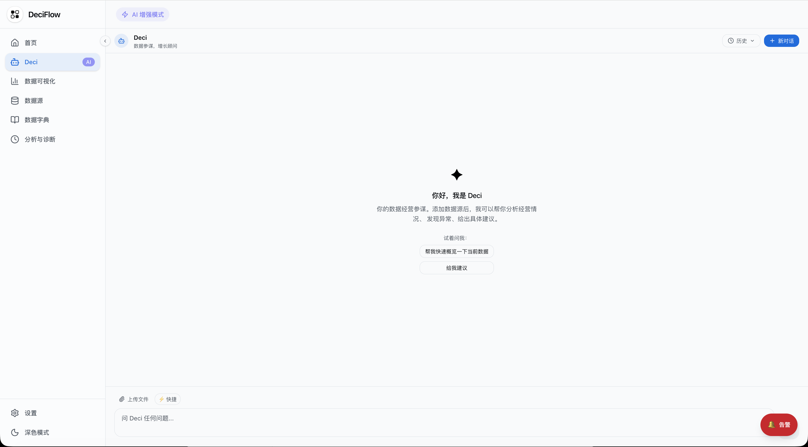
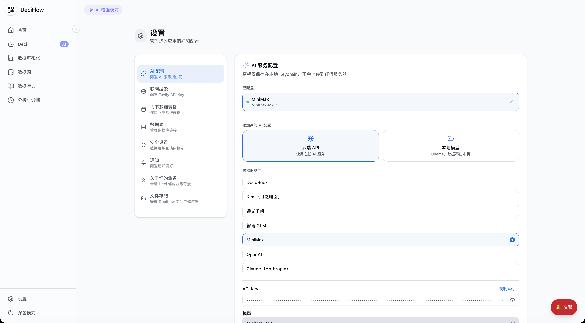
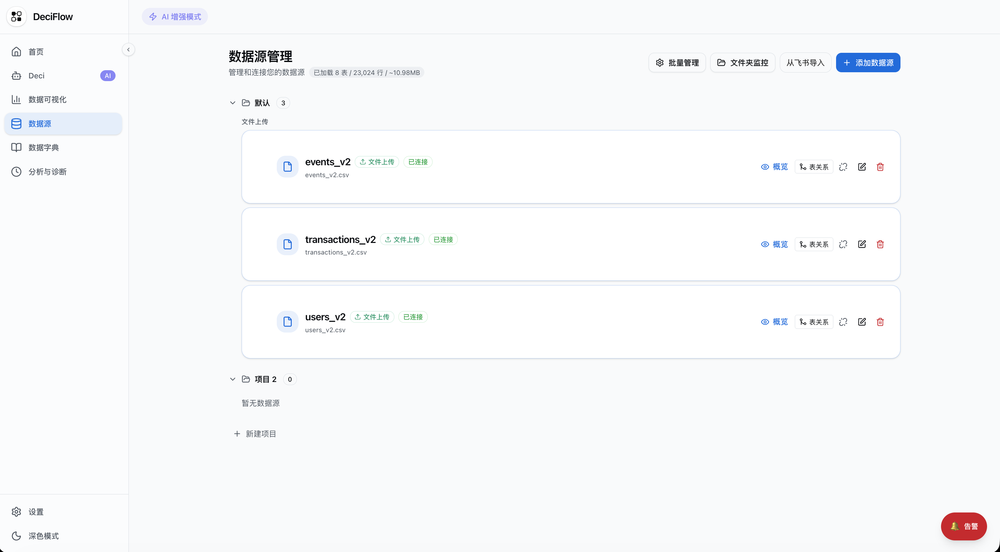
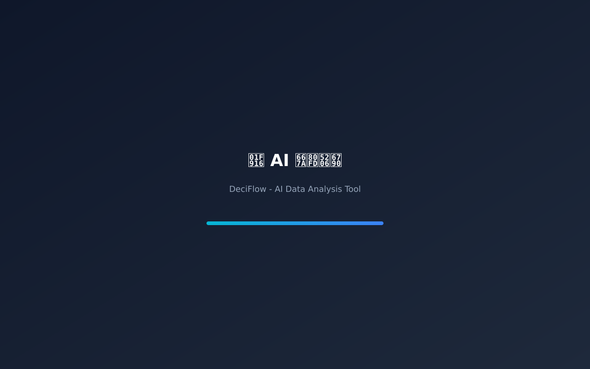

<p align="center">
  
</p>

<h1 align="center">DeciFlow</h1>

<p align="center">本地优先的 AI 数据分析助手 · 面向运营、产品、业务人员</p>

<p align="center">
  
  
  
  
  
</p>

<p align="center">
  <a href="#下载安装">下载</a> ·
  <a href="#快速开始">快速开始</a> ·
  <a href="https://github.com/Terry-Xxxu/DeciFlow-releases/issues">反馈问题</a>
</p>

---



---

## 产品简介

DeciFlow 是一款运行在本地的 AI 数据分析工具,数据全程留存在本机,AI 服务商由用户自配(主流云端接口或 Ollama 等本地模型)。面向运营、产品、业务人员设计:不需要会写 SQL,也能做数据分析和出报告。

设计取向:

- **本地优先** — 文件与数据库连接信息都存在本机,不上传任何服务器
- **自备 AI** — 用户配置自己的 API Key,适配云端与本地模型,适配私有化部署
- **可对话的分析助手 Deci** — 用自然语言提问,自动执行查询、生成图表、写报告

---

## 核心功能

### Deci — 内置 AI 数据助手



Deci 是 DeciFlow 内置的 AI 数据助手,具备完整的数据分析工具链:

- 理解业务语言,支持用字段别名和自定义指标提问
- 自动执行 SQL 查询、生成图表、发现数据异常
- 配置监控规则,指标超阈值时主动推送告警
- 生成结构化经营分析报告,导出为 Word 文档
- 支持飞书机器人接入,在飞书中直接与 Deci 对话

### 数据接入

| 类型 | 支持范围 |
|------|---------|
| 文件 | CSV、Excel(支持多 Sheet) |
| 关系型数据库 | PostgreSQL、MySQL、SQLite、SQL Server |
| NoSQL | MongoDB、Redis |
| 列式数据库 | ClickHouse |
| 连接方式 | 直连、SSH 隧道、SSL/TLS |

> 数据库直连功能已规划,目前以本地文件导入为主要数据来源。

### 分析工具

**快捷分析**:基于字段说明和行业知识,一键发现值得看的方向,自动生成图表和洞察。

**SQL 编辑器**:支持 SQL 语法高亮,Cmd/Ctrl+Enter 快捷执行,结果一键导出 CSV。

**数据透视表**:行列字段自由组合,支持 SUM、COUNT、AVG、MAX、MIN 聚合,可按值排序和显示合计。

**图表系统**:折线图、柱状图、饼图、面积图、漏斗图、热力图。点击数据点可下钻查看原始数据。

**计算字段**:基于现有字段创建派生列,支持数学运算和字符串拼接。

### 数据治理

**数据字典**:为字段配置中文名、业务含义和分析建议,自动注入 AI 上下文,提升查询准确性。

**表关系配置**:支持手动添加跨表 JOIN 关系,Deci 在跨表分析时自动使用。

**涉密配置**:标记敏感表或字段,查询结果自动掩码,支持手机号、邮箱、身份证的格式化脱敏。

### AI 配置

支持的 AI 服务商:

| 服务商 | 说明 |
|--------|------|
| Anthropic Claude | claude 系列 |
| OpenAI | GPT-4o 等系列 |
| DeepSeek | deepseek-chat 等系列 |
| Moonshot Kimi | moonshot-v1 系列 |
| 阿里云通义千问 | qwen-plus 等系列 |
| 智谱 GLM | glm-4 等系列 |
| MiniMax | abab6.5 等系列 |
| Ollama | 本地部署,支持任意模型 |

所有服务商支持自定义 API 地址,适配私有化部署场景。无 AI 配置时,SQL 编辑器、透视表、计算字段等功能仍可正常使用。

---

## 下载安装

前往 [Releases 页面](https://github.com/Terry-Xxxu/DeciFlow-releases/releases/latest) 下载安装包。

| 平台 | 安装包 |
|------|--------|
| macOS Apple Silicon(M 系列) | `DeciFlow-2.1.0-arm64.dmg` |

其他平台(Windows / Linux / Intel macOS):规划中。旧版本可在 Releases 页面查看历史。

### macOS 首次启动说明

由于安装包暂未做 Apple 开发者签名,首次打开时系统可能提示「无法验证开发者」或「应用已损坏,无法打开」,这是正常现象,不影响使用。请按以下方式处理:

- 提示「无法验证开发者」时:
  - **方式一**:右键(Control + 点击)DeciFlow 图标,选择「打开」,在弹窗中点「打开」
  - **方式二**:打开「系统设置 → 隐私与安全性」,在底部找到「DeciFlow 仍被阻止」,点「仍要打开」
- 提示「应用已损坏,无法打开」或上述方式都失败时,在终端执行:
  ```bash
  xattr -cr /Applications/DeciFlow.app
  ```
  然后重新打开 DeciFlow。

---

## 快速开始

**第一步:配置 AI 服务商(可选)**

打开「设置 → AI 配置」,选择一个服务商,填入 API Key。推荐 Claude 或 GPT-4o 以获得最佳分析质量。



**第二步:导入数据**

支持拖拽 CSV 或 Excel 文件直接导入,或在「数据源」页面添加数据库连接。



**第三步:填写业务背景**

在「设置 → 业务背景」中填写你的行业、当前关注的方向,这些信息会被 Deci 在分析时自动考虑。

**第四步:开始分析**

在首页选择数据表,点击快捷分析,或直接在 Deci 对话框中用自然语言提问:

- 分析上个月每天的销售额趋势
- 找出退款率最高的几个产品类目
- 对比各地区的客单价和转化率

分析完成后可在「数据图表」页保存为图表,持续追踪。



---

## 安全说明

- 数据文件和数据库连接配置均存储在本地,不上传任何服务器
- API Key 使用系统 Keychain 加密存储(macOS Keychain / Windows Credential Manager)
- 所有 SQL 查询经过安全校验,禁止 INSERT、UPDATE、DELETE 等写操作
- 涉密字段支持自动掩码,敏感数据不会出现在 AI 上下文中

---

## 技术栈

| 类别 | 技术 |
|------|------|
| 前端 | React 19、TypeScript、Tailwind CSS |
| 桌面框架 | Electron 41 |
| 图表 | Recharts |
| 文件数据库 | alasql、better-sqlite3 |
| 关系型数据库 | node-postgres、mysql2、mssql |
| NoSQL | mongodb、ioredis |
| 构建工具 | Vite、electron-builder |

---

## 反馈与支持

- 提交 Bug 或功能建议:[Issues](https://github.com/Terry-Xxxu/DeciFlow-releases/issues)

---

© 2026 Terry. 保留所有权利,仅供评估试用。